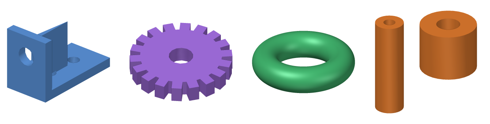

# modelthumb

**Vorschaubilder für 3D-Modelle in Linux-Dateimanagern. Eine AppImage, keine Grafikkarte nötig.**

[English version](README.md)



modelthumb zeigt Vorschaubilder für 3D-Druck- und CAD-Dateien direkt im Dateimanager.
Entwickelt wurde es für **Pop!_OS mit COSMIC**. Es funktioniert aber auch mit GNOME Files
(Nautilus), Nemo, Caja, Thunar und anderen Dateimanagern, die `.thumbnailer`-Dateien nach dem
freedesktop-Standard unterstützen.

| Format | Endungen | Hinweis |
|---|---|---|
| STL | `.stl` | binär und ASCII |
| 3MF | `.3mf`, `.gcode.3mf` | ein eingebettetes Slicer-Vorschaubild wird direkt verwendet, sonst wird das Mesh gerendert (auch Mehrteil-Projekte aus Bambu Studio und PrusaSlicer) |
| STEP | `.step`, `.stp` | über OpenCASCADE (mitgelieferte `libgmsh`) |
| IGES, BREP | `.iges`, `.igs`, `.brep` | wie STEP |
| OBJ, PLY, OFF | `.obj`, `.ply`, `.off` | |
| glTF | `.glb`, `.gltf` | |

## Funktionen

- **Software-Rendering in Rust.** Weder OpenGL noch GPU oder Display-Server sind nötig. Deshalb
  läuft es auch in der Thumbnailer-Sandbox von Nautilus und auf Rechnern ohne funktionierende
  3D-Treiber. Ein Vorschaubild mit 256 px dauert typischerweise 0,05–0,4 s.
- **Eine AppImage für alle Distributionen.** Das Programm braucht nur glibc 2.17 oder neuer.
- **Bettet Vorschaubilder in 3MF-Dateien ein** (`Metadata/thumbnail.png`, das Standardfeld, das
  auch Windows Explorer und Slicer lesen).
- **Füllt den Vorschau-Cache im Voraus** für ganze Ordner, damit die Bilder sofort da sind.
- Glatte Schattierung mit scharfen CAD-Kanten, Umrisslinien und transparentem Hintergrund.

## Installation

Lade `modelthumb-x86_64.AppImage` von der [Release-Seite](../../releases) herunter. Dann:

```bash
chmod +x modelthumb-x86_64.AppImage
```
```bash
./modelthumb-x86_64.AppImage install
```

Danach den Dateimanager neu starten (COSMIC: `pkill cosmic-files`, GNOME: `nautilus -q`).

**GNOME Files (Nautilus)** führt Thumbnailer in einer Sandbox aus, die dein Home-Verzeichnis nicht
sieht. Dort stattdessen systemweit installieren:

```bash
sudo ./modelthumb-x86_64.AppImage install --system
```

Startest du die AppImage per Doppelklick ohne Terminal, fragt ein Dialog nach der Installation.
Dafür muss `zenity` oder `kdialog` installiert sein. Die Installation kopiert die Laufzeit nach
`~/.local/share/modelthumb` (bzw. `/usr/local/lib/modelthumb`). Die AppImage-Datei kann danach
gelöscht werden.

Deinstallieren: `modelthumb uninstall` bzw. `sudo modelthumb uninstall --system`.

## Verwendung

Der Dateimanager ruft modelthumb automatisch auf. Auf der Kommandozeile geht außerdem:

```bash
# ein Bild rendern
modelthumb render teil.step -s 1024 -o teil.png --background "#ffffff" --color "#e07020"
modelthumb render teil.stl --azimuth 45 --elevation 20

# Vorschaubild in 3MF-Dateien speichern (vorhandene Slicer-Bilder bleiben, außer mit --force)
modelthumb embed -r ~/3D-Modelle/

# Vorschaubilder für einen Ordner im Voraus erzeugen (~/.cache/thumbnails)
modelthumb cache -r ~/3D-Modelle/
```

**Warum lässt sich bei STL oder STEP kein Vorschaubild einbetten?** Diese Formate haben kein Feld
dafür, das ein Dateimanager liest. Unter Linux liegen Vorschaubilder im gemeinsamen Cache
`~/.cache/thumbnails`, und den füllt `modelthumb cache`.

## Ähnliche Projekte

- [F3D](https://f3d.app): ein vollständiger 3D-Viewer, der auch Thumbnailer mitbringt, inklusive
  STEP/IGES über sein OCCT-Plugin. Rendert mit VTK/OpenGL.
- [stl-thumb](https://github.com/unlimitedbacon/stl-thumb): ein schlanker STL-Thumbnailer.
- gnome-model-thumbnailer und [gnome-thumbnailers](https://github.com/rcarmo/gnome-thumbnailers).

modelthumb setzt auf eine einzige, in sich geschlossene AppImage, Rendering ohne GPU und
3D-Druck-Abläufe (3MF-Vorschaubilder aus Slicern, Einbetten von Vorschaubildern in 3MF).

## Bauen

```bash
pip install ziglang cargo-zigbuild    # optional: ergibt ein Programm für glibc >= 2.17
```
```bash
./build-appimage.sh                   # -> dist/modelthumb-x86_64.AppImage
```

Das Skript lädt `libgmsh` (STEP-Import) von PyPI und kleine X11/GLU-Ersatzbibliotheken aus
Ubuntu 20.04. Diese werden nur geladen, wenn sie auf dem System fehlen. Anschließend packt
`appimagetool` alles zusammen. Die Tests laufen mit `cargo test`.

Wird ein Tag wie `v1.0.0` gepusht, baut GitHub Actions die AppImage und veröffentlicht ein Release.

## Lizenz

modelthumb ist freie Software unter der [GNU GPL v3.0 oder neuer](LICENSE).
Die AppImage enthält Gmsh (GPL-2.0-or-later) und Open CASCADE (LGPL-2.1 mit Ausnahme), siehe
[THIRD-PARTY-LICENSES.md](THIRD-PARTY-LICENSES.md).
