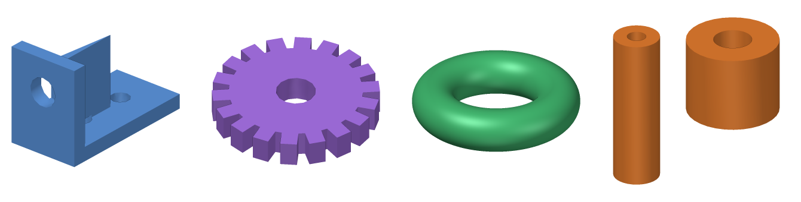

# modelthumb

**3D model thumbnails for Linux file managers. One AppImage, no GPU needed.**

[Deutsche Version](README.de.md)



modelthumb shows preview images for 3D printing and CAD files directly in your file manager.
It was built for **Pop!_OS with the COSMIC desktop** and also works with GNOME Files (Nautilus),
Nemo, Caja, Thunar and other file managers that support freedesktop `.thumbnailer` files.

| Format | Extensions | Notes |
|---|---|---|
| STL | `.stl` | binary and ASCII |
| 3MF | `.3mf`, `.gcode.3mf` | uses the slicer's embedded preview if there is one, otherwise renders the mesh (multi-part Bambu Studio / PrusaSlicer projects included) |
| STEP | `.step`, `.stp` | via OpenCASCADE (bundled `libgmsh`) |
| IGES, BREP | `.iges`, `.igs`, `.brep` | same as STEP |
| OBJ, PLY, OFF | `.obj`, `.ply`, `.off` | |
| glTF | `.glb`, `.gltf` | |

## Features

- **Software rendering in Rust.** No OpenGL, GPU or display server needed, so it also works inside
  the Nautilus thumbnailer sandbox and on machines without working 3D drivers.
  A 256 px preview typically takes 0.05–0.4 s.
- **One AppImage for every distribution.** The binary only needs glibc 2.17 or newer.
- **Embeds previews into 3MF files** (`Metadata/thumbnail.png`, the standard field that Windows
  Explorer and slicers read too).
- **Pre-fills the thumbnail cache** for whole folders, so previews appear instantly.
- Smooth shading with crisp CAD edges, outlines and a transparent background.

## Installation

Download `modelthumb-x86_64.AppImage` from the [releases page](../../releases), then:

```bash
chmod +x modelthumb-x86_64.AppImage
```
```bash
./modelthumb-x86_64.AppImage install
```

Restart your file manager (COSMIC: `pkill cosmic-files`, GNOME: `nautilus -q`).

**GNOME Files (Nautilus)** runs thumbnailers in a sandbox that cannot see your home directory.
Install system-wide instead:

```bash
sudo ./modelthumb-x86_64.AppImage install --system
```

Started by double click (without a terminal), the AppImage asks whether to install (needs `zenity`
or `kdialog`). The installer copies the runtime to `~/.local/share/modelthumb`
(or `/usr/local/lib/modelthumb`), so the AppImage file can be deleted afterwards.

Uninstall with `modelthumb uninstall` or `sudo modelthumb uninstall --system`.

## Usage

The file manager calls modelthumb automatically. You can also use it on the command line:

```bash
# render a picture
modelthumb render part.step -s 1024 -o part.png --background "#ffffff" --color "#e07020"
modelthumb render part.stl --azimuth 45 --elevation 20

# store a preview inside 3MF files (keeps existing slicer previews unless --force)
modelthumb embed -r ~/3d-models/

# generate previews for a folder in advance (~/.cache/thumbnails)
modelthumb cache -r ~/3d-models/
```

**Why can't STL or STEP files carry an embedded preview?** These formats have no field for one
that file managers read. On Linux, previews live in the shared cache `~/.cache/thumbnails`,
which `modelthumb cache` fills.

## Similar projects

- [F3D](https://f3d.app): a full 3D viewer that also ships thumbnailers, including STEP/IGES
  through its OCCT plugin. Uses VTK/OpenGL rendering.
- [stl-thumb](https://github.com/unlimitedbacon/stl-thumb): a lightweight STL thumbnailer.
- gnome-model-thumbnailer and [gnome-thumbnailers](https://github.com/rcarmo/gnome-thumbnailers).

modelthumb focuses on a single self-contained AppImage, rendering without a GPU, and 3D-printing
workflows (3MF previews from slicers, embedding previews into 3MF).

## Building

```bash
pip install ziglang cargo-zigbuild    # optional: builds a binary for glibc >= 2.17
```
```bash
./build-appimage.sh                   # -> dist/modelthumb-x86_64.AppImage
```

The script downloads `libgmsh` (STEP import) from PyPI and small X11/GLU fallback libraries from
Ubuntu 20.04. These are only loaded when the system lacks them. `appimagetool` then packs everything.
Run the tests with `cargo test`.

Pushing a tag such as `v1.0.0` makes GitHub Actions build the AppImage and publish a release.

## License

modelthumb is free software under the [GNU GPL v3.0 or later](LICENSE).
The AppImage bundles Gmsh (GPL-2.0-or-later) and Open CASCADE (LGPL-2.1 with exception); see
[THIRD-PARTY-LICENSES.md](THIRD-PARTY-LICENSES.md).
